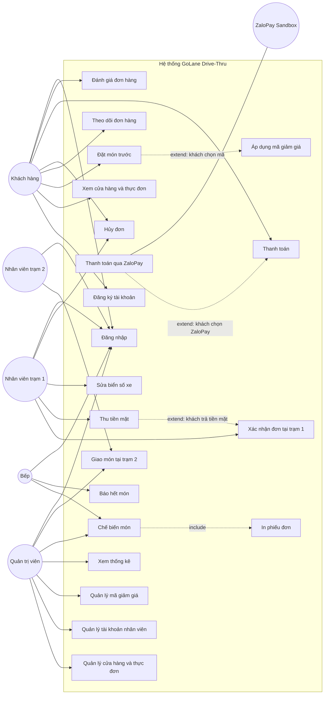
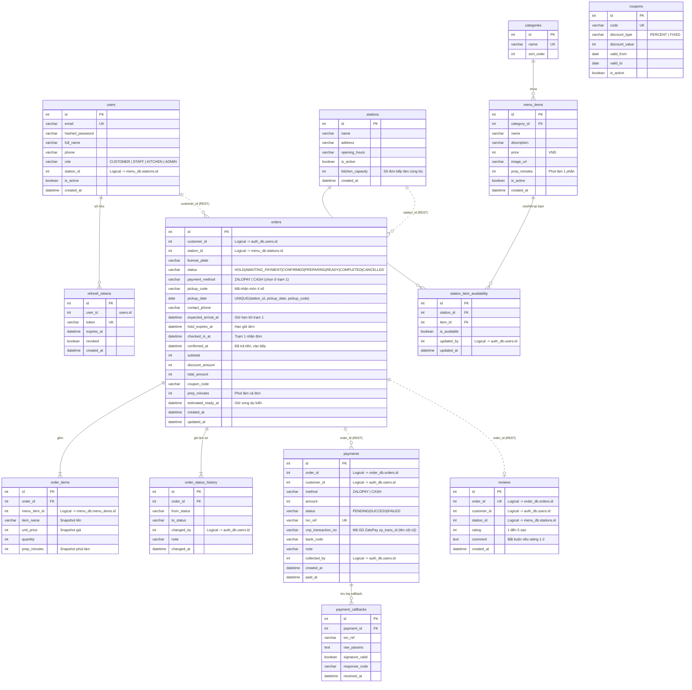
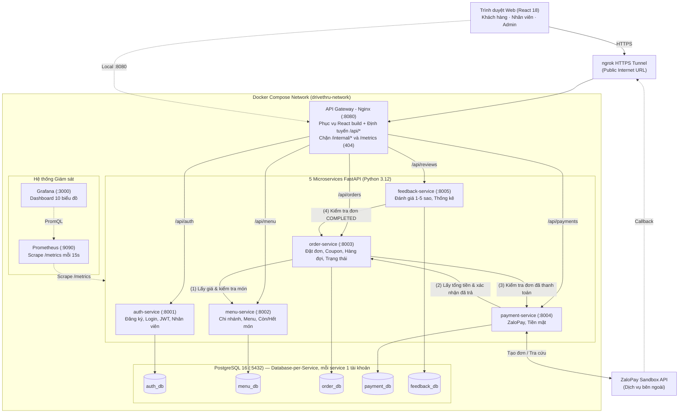
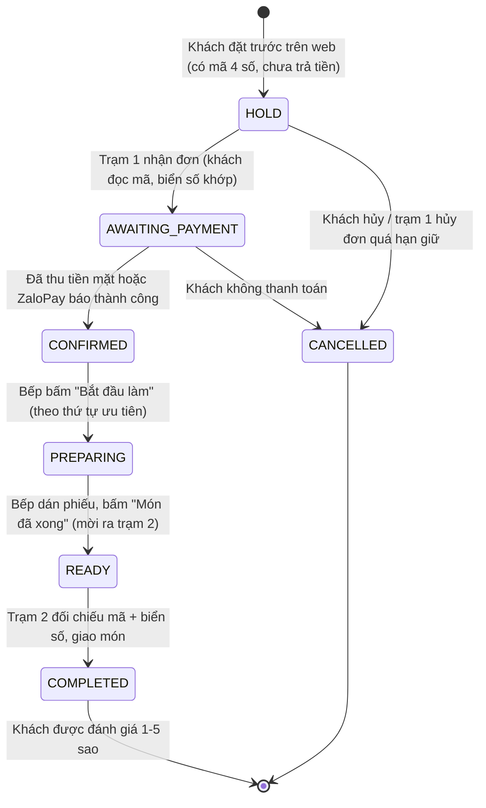

# 📐 TÀI LIỆU PHÂN TÍCH & THIẾT KẾ HỆ THỐNG GOLANE DRIVE-THRU

Tài liệu này được tổng hợp **nhất quán 100% với mã nguồn thực tế** của 5 microservices (`auth-service`, `menu-service`, `order-service`, `payment-service`, `feedback-service`), phục vụ trực tiếp cho phần **1. Phân tích & thiết kế hệ thống (1.5đ)** trong báo cáo cuối kỳ.

---

## 1. SƠ ĐỒ USE CASE TỔNG QUÁT (5 TÁC NHÂN + 1 HỆ THỐNG NGOÀI)

Mô hình vận hành **2 trạm**: khách đặt trước trên web (chưa trả tiền) và nhận **mã nhận món 4 số** → tới **trạm 1** đọc mã, nhân viên đối chiếu biển số, khách trả tiền → đơn vào **bếp**, xe chờ ở bãi → món xong, khách ra **trạm 2** đọc mã nhận món.

### Các tác nhân (Actors):
1. **Khách hàng (`CUSTOMER`)**: Đặt món trước, nhận mã, thanh toán tại trạm 1, theo dõi đơn, hủy đơn chưa thanh toán, đánh giá.
2. **Nhân viên trạm 1 (`STAFF`)**: Tìm đơn theo mã / biển số, đối chiếu biển số qua camera, nhận đơn và thu tiền mặt (hoặc chờ khách trả ZaloPay), sửa biển số sau khi xác minh, hủy đơn quá hạn giữ.
3. **Bếp (`KITCHEN`)**: Báo hết món (bếp biết nguyên liệu), làm món theo hàng đợi ưu tiên, in phiếu dán lên túi, báo món đã xong.
4. **Nhân viên trạm 2 (`STAFF`)**: Nghe mã khách đọc, đối chiếu biển số, giao món. (Trạm 1 và trạm 2 dùng chung vai trò `STAFF`, khác màn hình; trên sơ đồ tách 2 tác nhân vì là 2 vị trí làm việc.)
5. **Quản trị viên (`ADMIN`)**: Quản lý cửa hàng, thực đơn, mã giảm giá, tài khoản nhân viên trạm / bếp, xem thống kê; làm thay được việc của bếp và trạm 2 khi cần.
6. **ZaloPay Sandbox (hệ thống ngoài)**: Thu tiền online (QR, thẻ ATM, thẻ quốc tế), gửi callback và cho tra cứu trạng thái giao dịch.

Nhân viên trạm và bếp **gắn với một chi nhánh** (`station_id` trong JWT) và chỉ thao tác được đơn / món của chi nhánh đó.

Ghi chú cách vẽ: tên use case là **mục tiêu của người dùng** (không ghi công nghệ như JWT, không gộp nhiều việc bằng "/" hay "&"). `<<extend>>` chỉ xảy ra khi có điều kiện (chọn mã giảm giá, chọn ZaloPay, trả tiền mặt); `<<include>>` là bước luôn có (chế biến món luôn kèm in phiếu).

### Bảng đặc tả Use Case tóm tắt theo Service:

| Mã UC | Tên Use Case | Tác nhân | Service xử lý | Nghiệp vụ cốt lõi |
|---|---|---|---|---|
| **UC01–02** | Đăng nhập / Đăng ký | Tất cả / Khách | `auth-service` | Băm mật khẩu `bcrypt`, cấp JWT (`sub`, `role`, `station_id`) + refresh token. Đăng ký công khai luôn là `CUSTOMER`. |
| **UC03** | Xem cửa hàng và thực đơn | Khách hàng | `menu-service` | Cửa hàng đang mở, món kèm còn/hết tại từng chi nhánh. |
| **UC04** | Đặt món trước | Khách hàng | `order-service`, `menu-service` | Nhập biển số, **số điện thoại**, chọn tới trong 15/30/45 phút. Giá lấy từ `menu-service`. Đơn ở `HOLD`, nhận **mã 4 số** không trùng trong ngày tại chi nhánh. Giữ đơn tới giờ hẹn + 10 phút. **Chưa thu tiền.** |
| **UC05** | Áp dụng mã giảm giá | Khách hàng | `order-service` | Mã `PERCENT` / `FIXED` còn hạn; giảm không vượt tiền hàng. |
| **UC06** | Theo dõi đơn hàng | Khách hàng | `order-service` | Trang đơn hiện mã, hạn giữ, giờ xong dự kiến; tự cập nhật, báo "Mời ra trạm 2" khi món xong. |
| **UC07** | Hủy đơn | Khách hàng, Nhân viên trạm 1 | `order-service`, `payment-service` | Chỉ đơn **chưa trả tiền** (`HOLD`, `AWAITING_PAYMENT`). Đơn quá hạn giữ được tô đỏ, nhân viên xem SĐT và tự quyết định hủy; **hệ thống không tự hủy**. Đang trả ZaloPay thì hỏi lại ZaloPay trước khi hủy. Không bao giờ phải hoàn tiền. |
| **UC08–09** | Thanh toán (ZaloPay) | Khách hàng, ZaloPay | `payment-service` | Chỉ khi trạm 1 đã nhận đơn (`AWAITING_PAYMENT`). ZaloPay: ký `key1`, callback kiểm `key2` + số tiền, tra cứu khi callback chưa tới; xong thì báo `order-service` đưa đơn vào bếp. |
| **UC11** | Xác nhận đơn tại trạm 1 | Nhân viên trạm 1 | `order-service` | Tìm theo mã / biển số, đối chiếu biển số qua camera, `HOLD → AWAITING_PAYMENT`, chọn cách trả (đổi được khi chưa trả). |
| **UC12** | Thu tiền mặt | Nhân viên trạm 1 | `payment-service`, `order-service` | Ghi giao dịch `CASH` rồi báo `order-service` `AWAITING_PAYMENT → CONFIRMED` (vào bếp). Bấm lại vẫn an toàn. |
| **UC13** | Sửa biển số xe | Khách (khi đơn còn treo), Nhân viên trạm 1 | `order-service` | Biển số không khớp: xác minh tên / 3 số cuối SĐT rồi sửa; ghi lịch sử người sửa. |
| **UC14–15** | Chế biến món, In phiếu | Bếp | `order-service` | Hàng đợi bếp: đơn đang làm → đơn chờ quá 10 phút → **đơn làm nhanh trước**. In phiếu 80mm (mã, biển số, món) dán lên túi. `CONFIRMED → PREPARING → READY`; giờ dự kiến tính lại cho cả hàng đợi. |
| **UC16** | Báo hết món | Bếp | `menu-service` | Chỉ ở chi nhánh của mình (STAFF không có quyền này). |
| **UC17** | Giao món tại trạm 2 | Nhân viên trạm 2 | `order-service` | Khách đọc mã, đối chiếu biển số, `READY → COMPLETED`. |
| **UC10** | Đánh giá đơn hàng | Khách hàng | `feedback-service` | Chỉ đơn `COMPLETED`, mỗi đơn 1 lần; 1–2 sao bắt buộc lý do. |
| **UC18–21** | Quản trị | Admin | Tất cả 5 service | Cửa hàng (`kitchen_capacity`), món (`prep_minutes`), tài khoản STAFF / KITCHEN theo chi nhánh, mã giảm giá, thống kê. |

---

## 2. SƠ ĐỒ ERD (ENTITY RELATIONSHIP DIAGRAM - DATABASE PER SERVICE)

Hệ thống áp dụng mẫu **Database-per-Service**: 5 database độc lập trên PostgreSQL 16.
- **Đường nét liền**: Khóa ngoại vật lý (`FOREIGN KEY`) trong cùng 1 database.
- **Đường nét đứt**: Tham chiếu logic bằng ID giữa các database khác nhau (không dùng FK vật lý để đảm bảo tính độc lập của Microservices).
- **Phân quyền ở mức PostgreSQL**: mỗi service đăng nhập bằng tài khoản riêng và chỉ vào được database của mình (xem mục 2.1).

### 2.1. Tài khoản PostgreSQL theo từng service

| Service | Tài khoản | Database sở hữu | Vào database khác |
|---|---|---|---|
| `auth-service` | `auth_user` | `auth_db` | Bị chặn (`permission denied`) |
| `menu-service` | `menu_user` | `menu_db` | Bị chặn |
| `order-service` | `order_user` | `order_db` | Bị chặn |
| `payment-service` | `payment_user` | `payment_db` | Bị chặn |
| `feedback-service` | `feedback_user` | `feedback_db` | Bị chặn |

- `init-dbs.sh` tạo các tài khoản khi PostgreSQL khởi tạo lần đầu: mỗi tài khoản là **chủ** (`OWNER`) database của mình và quyền `CONNECT` mặc định của `PUBLIC` bị thu hồi.
- Tài khoản `admin` chỉ dùng để quản trị và xem dữ liệu, các service không dùng.
- Service cần dữ liệu của service khác thì **bắt buộc** gọi REST API nội bộ (mục 4), không thể truy vấn chéo database.
- Kiểm tra: `bash scripts/check-db-isolation.sh` thử 5 tài khoản × 5 database và in bảng kết quả.

---

## 3. BẢNG QUAN HỆ CHI TIẾT CƠ SỞ DỮ LIỆU (13 BẢNG / 5 DATABASE)

### 3.1. Database `auth_db` (`auth-service`)

**Bảng `users`**
| Tên cột | Kiểu dữ liệu | Ràng buộc | Mô tả |
|---|---|---|---|
| `id` | `INTEGER` | `PK, AUTO_INCREMENT` | Khóa chính người dùng |
| `email` | `VARCHAR(255)` | `UNIQUE, NOT NULL, INDEX` | Email đăng nhập |
| `hashed_password` | `VARCHAR(255)` | `NOT NULL` | Mật khẩu đã băm bằng `bcrypt` |
| `full_name` | `VARCHAR(100)` | `NOT NULL` | Họ và tên |
| `phone` | `VARCHAR(20)` | `NULL` | Số điện thoại (10 số) |
| `role` | `VARCHAR(20)` | `NOT NULL, DEFAULT 'CUSTOMER'` | Vai trò: `CUSTOMER`, `STAFF` (trạm 1 / trạm 2), `KITCHEN` (bếp), `ADMIN` |
| `station_id` | `INTEGER` | `NULL` | Tham chiếu logic `stations.id` (bắt buộc với `STAFF`, `KITCHEN`) |
| `is_active` | `BOOLEAN` | `NOT NULL, DEFAULT TRUE` | Trạng thái hoạt động (Khóa/Mở tài khoản) |
| `created_at` | `TIMESTAMP` | `NOT NULL` | Thời điểm tạo |

**Bảng `refresh_tokens`**
| Tên cột | Kiểu dữ liệu | Ràng buộc | Mô tả |
|---|---|---|---|
| `id` | `INTEGER` | `PK, AUTO_INCREMENT` | Khóa chính |
| `user_id` | `INTEGER` | `NOT NULL, INDEX` | ID người dùng (`users.id`) |
| `token` | `VARCHAR(255)` | `UNIQUE, NOT NULL, INDEX` | Chuỗi refresh token |
| `expires_at` | `TIMESTAMP` | `NOT NULL` | Thời gian hết hạn |
| `revoked` | `BOOLEAN` | `NOT NULL, DEFAULT FALSE` | Đã thu hồi hay chưa |
| `created_at` | `TIMESTAMP` | `NOT NULL` | Thời điểm tạo |

---

### 3.2. Database `menu_db` (`menu-service`)

**Bảng `stations`**
| Tên cột | Kiểu dữ liệu | Ràng buộc | Mô tả |
|---|---|---|---|
| `id` | `INTEGER` | `PK, AUTO_INCREMENT` | Mã cửa hàng |
| `name` | `VARCHAR(100)` | `NOT NULL` | Tên cửa hàng (vd: GoLane Quận 7) |
| `address` | `VARCHAR(255)` | `NOT NULL` | Địa chỉ |
| `opening_hours` | `VARCHAR(50)` | `NULL` | Giờ mở cửa (vd: `06:00 - 23:00` hoặc `24/7`) |
| `is_active` | `BOOLEAN` | `DEFAULT TRUE` | Đang hoạt động / Ngừng hoạt động |
| `kitchen_capacity` | `INTEGER` | `DEFAULT 2, NOT NULL` | Số đơn bếp làm được cùng lúc (1–20), dùng để ước lượng thời gian chờ |
| `created_at` | `TIMESTAMPTZ` | `DEFAULT NOW()` | Thời điểm tạo |

**Bảng `categories`**
| Tên cột | Kiểu dữ liệu | Ràng buộc | Mô tả |
|---|---|---|---|
| `id` | `INTEGER` | `PK, AUTO_INCREMENT` | Mã danh mục |
| `name` | `VARCHAR(100)` | `UNIQUE, NOT NULL` | Tên danh mục (Burger, Gà rán, Đồ uống...) |
| `sort_order` | `INTEGER` | `DEFAULT 0` | Thứ tự hiển thị |

**Bảng `menu_items`**
| Tên cột | Kiểu dữ liệu | Ràng buộc | Mô tả |
|---|---|---|---|
| `id` | `INTEGER` | `PK, AUTO_INCREMENT` | Mã món ăn |
| `category_id` | `INTEGER` | `FK -> categories(id), INDEX` | Thuộc danh mục |
| `name` | `VARCHAR(100)` | `NOT NULL` | Tên món |
| `description` | `VARCHAR(500)` | `NULL` | Mô tả món |
| `price` | `INTEGER` | `NOT NULL` | Giá bán chung (VND) |
| `image_url` | `VARCHAR(500)` | `NULL` | Đường dẫn ảnh món |
| `prep_minutes` | `INTEGER` | `DEFAULT 3, NOT NULL` | Số phút bếp làm xong 1 phần (1–60) |
| `is_active` | `BOOLEAN` | `DEFAULT TRUE` | Còn kinh doanh hay ngừng bán |
| `created_at` | `TIMESTAMPTZ` | `DEFAULT NOW()` | Thời điểm tạo |

**Bảng `station_item_availability`**
| Tên cột | Kiểu dữ liệu | Ràng buộc | Mô tả |
|---|---|---|---|
| `id` | `INTEGER` | `PK, AUTO_INCREMENT` | Khóa chính |
| `station_id` | `INTEGER` | `FK -> stations(id), INDEX` | Cửa hàng |
| `item_id` | `INTEGER` | `FK -> menu_items(id), INDEX` | Món ăn (Cặp `station_id, item_id` là `UNIQUE`) |
| `is_available` | `BOOLEAN` | `DEFAULT TRUE` | Còn hàng (`TRUE`) / Hết hàng (`FALSE`) |
| `updated_by` | `INTEGER` | `NULL` | Tham chiếu logic `auth_db.users.id` |
| `updated_at` | `TIMESTAMPTZ` | `DEFAULT NOW()` | Thời điểm cập nhật |

---

### 3.3. Database `order_db` (`order-service`)

**Bảng `orders`**
| Tên cột | Kiểu dữ liệu | Ràng buộc | Mô tả |
|---|---|---|---|
| `id` | `INTEGER` | `PK, AUTO_INCREMENT` | Mã đơn hàng |
| `customer_id` | `INTEGER` | `NOT NULL, INDEX` | Tham chiếu logic `auth_db.users.id` |
| `station_id` | `INTEGER` | `NOT NULL, INDEX` | Tham chiếu logic `menu_db.stations.id` |
| `license_plate` | `VARCHAR(20)` | `NOT NULL` | Biển số xe nhận món |
| `status` | `VARCHAR(20)` | `NOT NULL, INDEX` | `HOLD`, `AWAITING_PAYMENT`, `CONFIRMED`, `PREPARING`, `READY`, `COMPLETED`, `CANCELLED` (đơn cũ có thể còn `PENDING_PAYMENT`, `ARRIVED`) |
| `payment_method` | `VARCHAR(10)` | `NULL` | `ZALOPAY` hoặc `CASH`, khách chọn ở trạm 1 |
| `pickup_code` | `VARCHAR(4)` | `INDEX` | Mã nhận món 4 số; `UNIQUE (station_id, pickup_date, pickup_code)` |
| `pickup_date` | `DATE` | `NULL` | Ngày đặt theo giờ Việt Nam (để mã không trùng trong ngày) |
| `contact_phone` | `VARCHAR(15)` | `NULL` | SĐT khách, nhân viên chi nhánh dùng khi cần gọi |
| `expected_arrival_at` | `TIMESTAMPTZ` | `NULL` | Giờ khách hẹn tới trạm 1 (15/30/45 phút sau khi đặt) |
| `hold_expires_at` | `TIMESTAMPTZ` | `NULL` | Hạn giữ đơn = giờ hẹn + 10 phút; quá hạn thì trạm 1 được hủy |
| `checked_in_at` | `TIMESTAMPTZ` | `NULL` | Lúc trạm 1 nhận đơn |
| `confirmed_at` | `TIMESTAMPTZ` | `NULL` | Lúc khách trả tiền xong, đơn vào bếp (dùng để xếp hàng đợi) |
| `subtotal` | `INTEGER` | `DEFAULT 0` | Tạm tính (VND) |
| `discount_amount` | `INTEGER` | `DEFAULT 0` | Số tiền giảm giá (VND) |
| `total_amount` | `INTEGER` | `DEFAULT 0` | Tổng thanh toán (VND) |
| `coupon_code` | `VARCHAR(30)` | `NULL` | Mã giảm giá đã áp dụng |
| `prep_minutes` | `INTEGER` | `DEFAULT 0, NOT NULL` | Số phút làm cả đơn = món lâu nhất + 1 phút cho mỗi 2 phần thêm |
| `estimated_ready_at` | `TIMESTAMPTZ` | `NULL` | Giờ xong dự kiến; tính lại cho cả hàng đợi bếp mỗi khi hàng đợi thay đổi |
| `arrived_at` | `TIMESTAMPTZ` | `NULL` | Cách làm cũ, đơn mới không dùng |
| `created_at` | `TIMESTAMPTZ` | `DEFAULT NOW()` | Thời điểm đặt đơn |
| `updated_at` | `TIMESTAMPTZ` | `DEFAULT NOW()` | Thời điểm cập nhật cuối |

**Bảng `order_items`**
| Tên cột | Kiểu dữ liệu | Ràng buộc | Mô tả |
|---|---|---|---|
| `id` | `INTEGER` | `PK, AUTO_INCREMENT` | Khóa chính |
| `order_id` | `INTEGER` | `FK -> orders(id), INDEX` | Thuộc đơn hàng |
| `menu_item_id` | `INTEGER` | `NOT NULL` | Tham chiếu logic `menu_db.menu_items.id` |
| `item_name` | `VARCHAR(100)` | `NOT NULL` | **Snapshot** tên món lúc đặt |
| `unit_price` | `INTEGER` | `NOT NULL` | **Snapshot** đơn giá lúc đặt |
| `quantity` | `INTEGER` | `NOT NULL` | Số lượng |
| `prep_minutes` | `INTEGER` | `DEFAULT 3, NOT NULL` | **Snapshot** số phút làm món lúc đặt |

**Bảng `order_status_history`**
| Tên cột | Kiểu dữ liệu | Ràng buộc | Mô tả |
|---|---|---|---|
| `id` | `INTEGER` | `PK, AUTO_INCREMENT` | Khóa chính |
| `order_id` | `INTEGER` | `FK -> orders(id), INDEX` | Đơn hàng |
| `from_status` | `VARCHAR(20)` | `NULL` | Trạng thái cũ |
| `to_status` | `VARCHAR(20)` | `NOT NULL` | Trạng thái mới |
| `changed_by` | `INTEGER` | `NULL` | Tham chiếu logic `auth_db.users.id` (`NULL` nếu hệ thống tự đổi) |
| `note` | `VARCHAR(200)` | `NULL` | Ghi chú (vd: đã thu tiền mặt, khách tới quầy) |
| `changed_at` | `TIMESTAMPTZ` | `DEFAULT NOW()` | Thời điểm chuyển trạng thái |

**Bảng `coupons`**
| Tên cột | Kiểu dữ liệu | Ràng buộc | Mô tả |
|---|---|---|---|
| `id` | `INTEGER` | `PK, AUTO_INCREMENT` | Khóa chính |
| `code` | `VARCHAR(30)` | `UNIQUE, NOT NULL, INDEX` | Mã giảm giá |
| `discount_type` | `VARCHAR(10)` | `NOT NULL` | `PERCENT` hoặc `FIXED` |
| `discount_value` | `INTEGER` | `NOT NULL` | Giá trị giảm (% hoặc VND) |
| `valid_from` | `DATE` | `NOT NULL` | Ngày bắt đầu hiệu lực |
| `valid_to` | `DATE` | `NOT NULL` | Ngày hết hạn |
| `is_active` | `BOOLEAN` | `DEFAULT TRUE` | Đang kích hoạt hay không |

---

### 3.4. Database `payment_db` (`payment-service`)

**Bảng `payments`**
| Tên cột | Kiểu dữ liệu | Ràng buộc | Mô tả |
|---|---|---|---|
| `id` | `INTEGER` | `PK, AUTO_INCREMENT` | Mã giao dịch nội bộ |
| `order_id` | `INTEGER` | `NOT NULL, INDEX` | Tham chiếu logic `order_db.orders.id` |
| `customer_id` | `INTEGER` | `NOT NULL, INDEX` | Tham chiếu logic `auth_db.users.id` |
| `method` | `VARCHAR(10)` | `NOT NULL` | `ZALOPAY` hoặc `CASH` |
| `amount` | `INTEGER` | `NOT NULL` | Số tiền (VND) |
| `status` | `VARCHAR(10)` | `DEFAULT 'PENDING', INDEX` | `PENDING`, `SUCCESS`, `FAILED` |
| `txn_ref` | `VARCHAR(40)` | `UNIQUE, NOT NULL, INDEX` | Mã tham chiếu giao dịch gửi ZaloPay (`app_trans_id`, dạng `yymmdd_...`) |
| `vnp_transaction_no` | `VARCHAR(40)` | `NULL` | Mã giao dịch ZaloPay trả về (`zp_trans_id`; giữ tên cột từ bản VNPay cũ; trong code là `transaction_no`) |
| `bank_code` | `VARCHAR(20)` | `NULL` | Mã ngân hàng / phương thức |
| `note` | `VARCHAR(200)` | `NULL` | Ghi chú |
| `collected_by` | `INTEGER` | `NULL` | ID nhân viên xác nhận thu tiền mặt |
| `created_at` | `TIMESTAMPTZ` | `DEFAULT NOW()` | Thời điểm tạo |
| `paid_at` | `TIMESTAMPTZ` | `NULL` | Thời điểm thanh toán thành công |

**Bảng `payment_callbacks`**
| Tên cột | Kiểu dữ liệu | Ràng buộc | Mô tả |
|---|---|---|---|
| `id` | `INTEGER` | `PK, AUTO_INCREMENT` | Khóa chính |
| `payment_id` | `INTEGER` | `FK -> payments(id), NULL, INDEX` | Giao dịch tương ứng |
| `txn_ref` | `VARCHAR(60)` | `NOT NULL, INDEX` | Mã tham chiếu |
| `raw_params` | `TEXT` | `NOT NULL` | Dữ liệu gốc ZaloPay gửi về hoặc kết quả tra cứu (để đối soát) |
| `signature_valid` | `BOOLEAN` | `NOT NULL` | Chữ ký HMAC-SHA256 hợp lệ hay không |
| `response_code` | `VARCHAR(5)` | `NULL` | Mã phản hồi từ ZaloPay (`1` = thành công) |
| `received_at` | `TIMESTAMPTZ` | `DEFAULT NOW()` | Thời điểm nhận callback |

---

### 3.5. Database `feedback_db` (`feedback-service`)

**Bảng `reviews`**
| Tên cột | Kiểu dữ liệu | Ràng buộc | Mô tả |
|---|---|---|---|
| `id` | `INTEGER` | `PK, AUTO_INCREMENT` | Khóa chính |
| `order_id` | `INTEGER` | `UNIQUE, NOT NULL, INDEX` | Tham chiếu logic `order_db.orders.id` (Mỗi đơn chỉ 1 đánh giá) |
| `customer_id` | `INTEGER` | `NOT NULL, INDEX` | Tham chiếu logic `auth_db.users.id` |
| `station_id` | `INTEGER` | `NOT NULL, INDEX` | Tham chiếu logic `menu_db.stations.id` |
| `rating` | `INTEGER` | `NOT NULL` | Số sao từ `1` đến `5` |
| `comment` | `TEXT` | `NULL` | Nội dung góp ý (Bắt buộc nếu `rating` là `1` hoặc `2`) |
| `created_at` | `TIMESTAMP` | `NOT NULL` | Thời điểm đánh giá |

---

## 4. SƠ ĐỒ KIẾN TRÚC MICROSERVICES TỔNG THỂ

Sơ đồ dưới đây thể hiện đầy đủ kiến trúc **GoLane Drive-Thru** đang chạy trong Docker Compose, bao gồm tầng Gateway, 5 Microservices, 5 Database độc lập, 4 luồng gọi nội bộ (`X-Internal-Key`), cổng thanh toán ZaloPay Sandbox và hệ thống giám sát Prometheus + Grafana.

### Bảng tổng hợp giao tiếp nội bộ giữa các Microservices:

| STT | Service gọi | Service nhận | Endpoint nội bộ (`X-Internal-Key`) | Mục đích nghiệp vụ |
| :---: | :--- | :--- | :--- | :--- |
| **1** | `order-service` | `menu-service` | `GET /internal/items?station_id=&ids=` | Lấy tên, giá gốc, số phút làm và kiểm tra món còn bán tại chi nhánh. |
| **1b** | `order-service` | `menu-service` | `GET /internal/stations` | Lấy số đơn bếp làm cùng lúc của từng cửa hàng để ước lượng thời gian chờ (lỗi thì dùng mặc định 2, không chặn đặt đơn). |
| **2** | `payment-service` | `order-service` | `GET /internal/orders/{id}` & `POST .../payment-confirmed` | Lấy số tiền cần thu; khi đã thu tiền mặt ở trạm 1 hoặc ZaloPay báo thành công thì chuyển đơn `AWAITING_PAYMENT → CONFIRMED` (vào bếp, kèm cách trả thật sự). |
| **3** | `order-service` | `payment-service` | `GET /internal/payments/order/{id}/paid?sync=true` | Trước khi hủy đơn đang chờ trả ZaloPay, payment-service hỏi lại ZaloPay các giao dịch đang chờ để không hủy nhầm đơn khách vừa trả xong. |
| **4** | `feedback-service` | `order-service` | `GET /internal/orders/{id}` | Xác minh đơn hàng đã `COMPLETED` và đúng chủ sở hữu trước khi cho phép đánh giá. |

---

## 5. SƠ ĐỒ MÁY TRẠNG THÁI ĐƠN HÀNG (ORDER STATE MACHINE)

> **Ghi chú nghiệp vụ**: chỉ hủy được đơn **chưa trả tiền**, và tiền chỉ thu ở trạm 1 ngay trước khi đơn vào bếp, nên hệ thống không bao giờ phải hoàn tiền. Đơn quá hạn giữ **không tự hủy**: trạm 1 thấy đơn tô đỏ kèm số điện thoại và quyết định. Xe sau trạm 1 chờ ở bãi, chỉ ra trạm 2 khi món đã xong, nên không có xe nào chặn làn.
