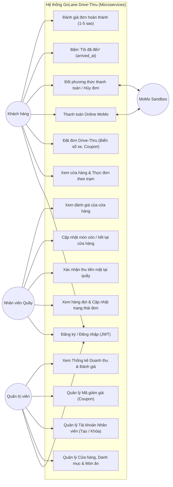
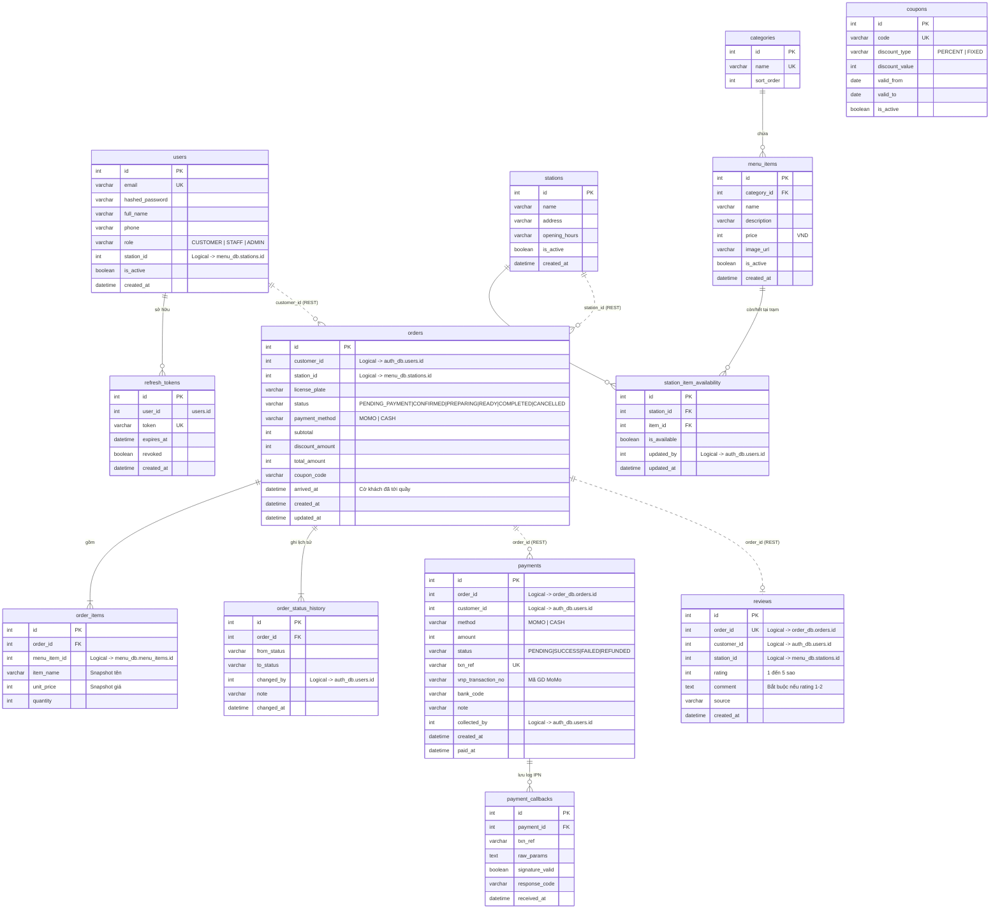
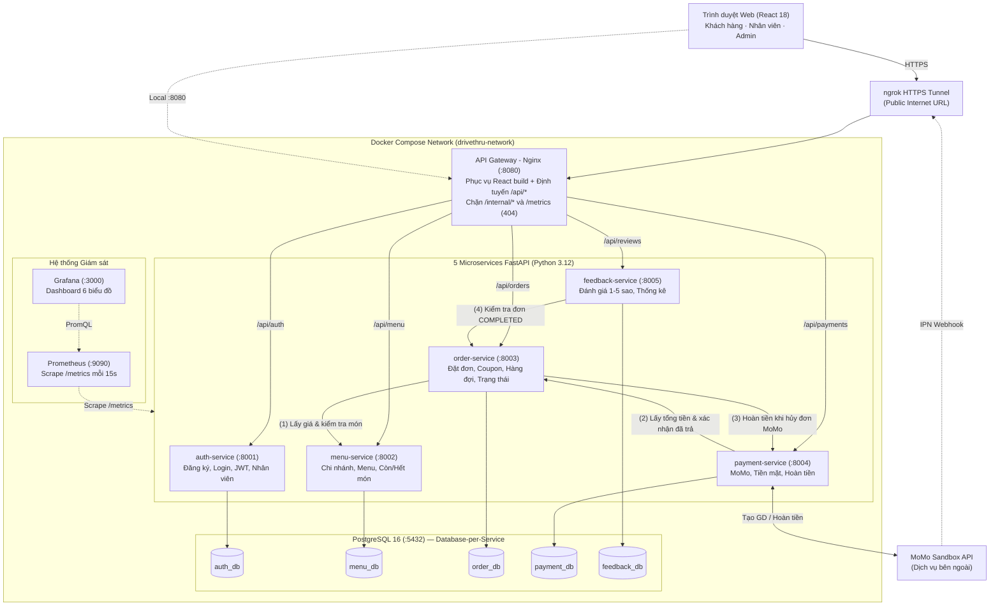
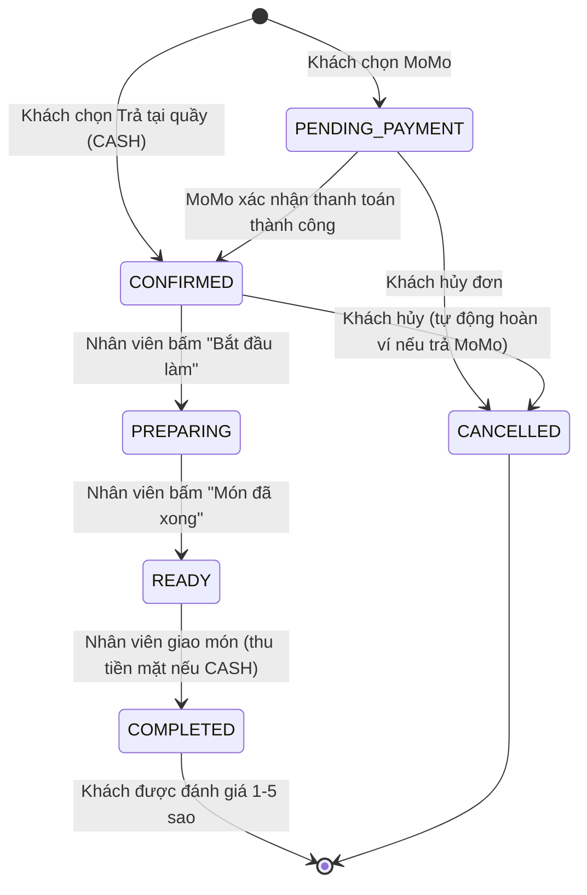

# 📐 TÀI LIỆU PHÂN TÍCH & THIẾT KẾ HỆ THỐNG GOLANE DRIVE-THRU

Tài liệu này được tổng hợp **nhất quán 100% với mã nguồn thực tế** của 5 microservices (`auth-service`, `menu-service`, `order-service`, `payment-service`, `feedback-service`), phục vụ trực tiếp cho phần **1. Phân tích & thiết kế hệ thống (1.5đ)** trong báo cáo cuối kỳ.

---

## 1. SƠ ĐỒ USE CASE TỔNG QUÁT (3 TÁC NHÂN + 1 HỆ THỐNG NGOÀI)

### Các tác nhân (Actors):
1. **Khách hàng (`CUSTOMER`)**: Đặt món, thanh toán, theo dõi tiến trình, báo "Tôi đã đến", hủy đơn, đánh giá.
2. **Nhân viên quầy (`STAFF`)**: Xử lý hàng đợi đơn tại cửa hàng mình phụ trách, thu tiền mặt, cập nhật món còn/hết, xem đánh giá của cửa hàng.
3. **Quản trị viên (`ADMIN`)**: Kế thừa toàn bộ quyền quản lý cửa hàng, thực đơn, mã giảm giá, tài khoản nhân viên và xem thống kê toàn hệ thống.
4. **Cổng thanh toán MoMo Sandbox (External System)**: Xử lý giao dịch thanh toán online, gửi kết quả IPN và xử lý hoàn tiền.

### Bảng đặc tả Use Case tóm tắt theo Service:

| Mã UC | Tên Use Case | Tác nhân | Service xử lý | Nghiệp vụ cốt lõi |
|---|---|---|---|---|
| **UC01** | Đăng ký / Đăng nhập | Tất cả | `auth-service` | Băm mật khẩu `bcrypt`, cấp `access_token` (JWT) + `refresh_token`. |
| **UC02** | Xem cửa hàng & Menu | Khách hàng | `menu-service` | Hiển thị cửa hàng đang mở, thực đơn kèm trạng thái còn/hết từng món. |
| **UC03** | Đặt đơn Drive-Thru | Khách hàng | `order-service` | Nhập biển số xe, chọn `MOMO` hoặc `CASH`, kiểm tra giá từ `menu-service`, áp dụng coupon. |
| **UC04** | Thanh toán MoMo | Khách hàng, MoMo | `payment-service` | Tạo link MoMo, xác thực chữ ký HMAC-SHA256, báo `order-service` sang `CONFIRMED`. |
| **UC05** | Hủy đơn / Đổi PTTT | Khách hàng | `order-service`, `payment-service` | Chỉ hủy/đổi trước khi `PREPARING`. Đơn MoMo đã trả tiền sẽ hoàn ví trước khi hủy. |
| **UC06** | Báo "Tôi đã đến" | Khách hàng | `order-service` | Ghi `arrived_at` để đẩy thẻ xe lên đầu hàng đợi và bật chuông báo trên màn hình quầy. |
| **UC07** | Đánh giá dịch vụ | Khách hàng | `feedback-service` | Chỉ đánh giá đơn `COMPLETED`, mỗi đơn 1 lần. Chấm 1–2 sao **bắt buộc** ghi lý do. |
| **UC08** | Điều phối hàng đợi | Nhân viên / Admin | `order-service` | Chuyển trạng thái theo máy trạng thái: `CONFIRMED` → `PREPARING` → `READY` → `COMPLETED`. |
| **UC09** | Xác nhận thu tiền mặt | Nhân viên / Admin | `payment-service` | Xác nhận đã thu tiền mặt tại quầy trước khi cho phép hoàn thành đơn `CASH`. |
| **UC10** | Bật/tắt món còn/hết | Nhân viên / Admin | `menu-service` | Nhân viên chỉ cập nhật tại `station_id` của mình; Admin sửa mọi cửa hàng. |
| **UC11–15** | Quản trị hệ thống | Admin | Tất cả 5 service | Quản lý cửa hàng, món, nhân viên, mã giảm giá, thống kê doanh thu & đánh giá. |

---

## 2. SƠ ĐỒ ERD (ENTITY RELATIONSHIP DIAGRAM - DATABASE PER SERVICE)

Hệ thống áp dụng mẫu **Database-per-Service**: 5 database độc lập trên PostgreSQL 16.
- **Đường nét liền**: Khóa ngoại vật lý (`FOREIGN KEY`) trong cùng 1 database.
- **Đường nét đứt**: Tham chiếu logic bằng ID giữa các database khác nhau (không dùng FK vật lý để đảm bảo tính độc lập của Microservices).

---

## 3. BẢNG QUAN HỆ CHI TIẾT CƠ SỞ DỮ LIỆU (13 BẢNG / 5 DATABASE)

### 3.1. Database `auth_db` (`auth-service`)

**Bảng `users`**
| Tên cột | Kiểu dữ liệu | Ràng buộc | Mô tả |
|---|---|---|---|
| `id` | `INTEGER` | `PK, AUTO_INCREMENT` | Khóa chính người dùng |
| `email` | `VARCHAR(255)` | `UNIQUE, NOT NULL, INDEX` | Email đăng nhập |
| `hashed_password` | `VARCHAR(255)` | `NOT NULL` | Mật khẩu đã băm bằng `bcrypt` |
| `full_name` | `VARCHAR(100)` | `NOT NULL` | Họ và tên |
| `phone` | `VARCHAR(20)` | `NULL` | Số điện thoại (10 số) |
| `role` | `VARCHAR(20)` | `NOT NULL, DEFAULT 'CUSTOMER'` | Vai trò: `CUSTOMER`, `STAFF`, `ADMIN` |
| `station_id` | `INTEGER` | `NULL` | Tham chiếu logic `stations.id` (dành cho `STAFF`) |
| `is_active` | `BOOLEAN` | `NOT NULL, DEFAULT TRUE` | Trạng thái hoạt động (Khóa/Mở tài khoản) |
| `created_at` | `TIMESTAMP` | `NOT NULL` | Thời điểm tạo |

**Bảng `refresh_tokens`**
| Tên cột | Kiểu dữ liệu | Ràng buộc | Mô tả |
|---|---|---|---|
| `id` | `INTEGER` | `PK, AUTO_INCREMENT` | Khóa chính |
| `user_id` | `INTEGER` | `NOT NULL, INDEX` | ID người dùng (`users.id`) |
| `token` | `VARCHAR(255)` | `UNIQUE, NOT NULL, INDEX` | Chuỗi refresh token |
| `expires_at` | `TIMESTAMP` | `NOT NULL` | Thời gian hết hạn |
| `revoked` | `BOOLEAN` | `NOT NULL, DEFAULT FALSE` | Đã thu hồi hay chưa |
| `created_at` | `TIMESTAMP` | `NOT NULL` | Thời điểm tạo |

---

### 3.2. Database `menu_db` (`menu-service`)

**Bảng `stations`**
| Tên cột | Kiểu dữ liệu | Ràng buộc | Mô tả |
|---|---|---|---|
| `id` | `INTEGER` | `PK, AUTO_INCREMENT` | Mã cửa hàng |
| `name` | `VARCHAR(100)` | `NOT NULL` | Tên cửa hàng (vd: GoLane Quận 7) |
| `address` | `VARCHAR(255)` | `NOT NULL` | Địa chỉ |
| `opening_hours` | `VARCHAR(50)` | `NULL` | Giờ mở cửa (vd: `06:00 - 23:00` hoặc `24/7`) |
| `is_active` | `BOOLEAN` | `DEFAULT TRUE` | Đang hoạt động / Ngừng hoạt động |
| `created_at` | `TIMESTAMPTZ` | `DEFAULT NOW()` | Thời điểm tạo |

**Bảng `categories`**
| Tên cột | Kiểu dữ liệu | Ràng buộc | Mô tả |
|---|---|---|---|
| `id` | `INTEGER` | `PK, AUTO_INCREMENT` | Mã danh mục |
| `name` | `VARCHAR(100)` | `UNIQUE, NOT NULL` | Tên danh mục (Burger, Gà rán, Đồ uống...) |
| `sort_order` | `INTEGER` | `DEFAULT 0` | Thứ tự hiển thị |

**Bảng `menu_items`**
| Tên cột | Kiểu dữ liệu | Ràng buộc | Mô tả |
|---|---|---|---|
| `id` | `INTEGER` | `PK, AUTO_INCREMENT` | Mã món ăn |
| `category_id` | `INTEGER` | `FK -> categories(id), INDEX` | Thuộc danh mục |
| `name` | `VARCHAR(100)` | `NOT NULL` | Tên món |
| `description` | `VARCHAR(500)` | `NULL` | Mô tả món |
| `price` | `INTEGER` | `NOT NULL` | Giá bán chung (VND) |
| `image_url` | `VARCHAR(500)` | `NULL` | Đường dẫn ảnh món |
| `is_active` | `BOOLEAN` | `DEFAULT TRUE` | Còn kinh doanh hay ngừng bán |
| `created_at` | `TIMESTAMPTZ` | `DEFAULT NOW()` | Thời điểm tạo |

**Bảng `station_item_availability`**
| Tên cột | Kiểu dữ liệu | Ràng buộc | Mô tả |
|---|---|---|---|
| `id` | `INTEGER` | `PK, AUTO_INCREMENT` | Khóa chính |
| `station_id` | `INTEGER` | `FK -> stations(id), INDEX` | Cửa hàng |
| `item_id` | `INTEGER` | `FK -> menu_items(id), INDEX` | Món ăn (Cặp `station_id, item_id` là `UNIQUE`) |
| `is_available` | `BOOLEAN` | `DEFAULT TRUE` | Còn hàng (`TRUE`) / Hết hàng (`FALSE`) |
| `updated_by` | `INTEGER` | `NULL` | Tham chiếu logic `auth_db.users.id` |
| `updated_at` | `TIMESTAMPTZ` | `DEFAULT NOW()` | Thời điểm cập nhật |

---

### 3.3. Database `order_db` (`order-service`)

**Bảng `orders`**
| Tên cột | Kiểu dữ liệu | Ràng buộc | Mô tả |
|---|---|---|---|
| `id` | `INTEGER` | `PK, AUTO_INCREMENT` | Mã đơn hàng |
| `customer_id` | `INTEGER` | `NOT NULL, INDEX` | Tham chiếu logic `auth_db.users.id` |
| `station_id` | `INTEGER` | `NOT NULL, INDEX` | Tham chiếu logic `menu_db.stations.id` |
| `license_plate` | `VARCHAR(20)` | `NOT NULL` | Biển số xe nhận món |
| `status` | `VARCHAR(20)` | `NOT NULL, INDEX` | `PENDING_PAYMENT`, `CONFIRMED`, `PREPARING`, `READY`, `COMPLETED`, `CANCELLED` |
| `payment_method` | `VARCHAR(10)` | `NOT NULL` | `MOMO` hoặc `CASH` |
| `subtotal` | `INTEGER` | `DEFAULT 0` | Tạm tính (VND) |
| `discount_amount` | `INTEGER` | `DEFAULT 0` | Số tiền giảm giá (VND) |
| `total_amount` | `INTEGER` | `DEFAULT 0` | Tổng thanh toán (VND) |
| `coupon_code` | `VARCHAR(30)` | `NULL` | Mã giảm giá đã áp dụng |
| `arrived_at` | `TIMESTAMPTZ` | `NULL` | Thời điểm khách bấm "Tôi đã đến" |
| `created_at` | `TIMESTAMPTZ` | `DEFAULT NOW()` | Thời điểm đặt đơn |
| `updated_at` | `TIMESTAMPTZ` | `DEFAULT NOW()` | Thời điểm cập nhật cuối |

**Bảng `order_items`**
| Tên cột | Kiểu dữ liệu | Ràng buộc | Mô tả |
|---|---|---|---|
| `id` | `INTEGER` | `PK, AUTO_INCREMENT` | Khóa chính |
| `order_id` | `INTEGER` | `FK -> orders(id), INDEX` | Thuộc đơn hàng |
| `menu_item_id` | `INTEGER` | `NOT NULL` | Tham chiếu logic `menu_db.menu_items.id` |
| `item_name` | `VARCHAR(100)` | `NOT NULL` | **Snapshot** tên món lúc đặt |
| `unit_price` | `INTEGER` | `NOT NULL` | **Snapshot** đơn giá lúc đặt |
| `quantity` | `INTEGER` | `NOT NULL` | Số lượng |

**Bảng `order_status_history`**
| Tên cột | Kiểu dữ liệu | Ràng buộc | Mô tả |
|---|---|---|---|
| `id` | `INTEGER` | `PK, AUTO_INCREMENT` | Khóa chính |
| `order_id` | `INTEGER` | `FK -> orders(id), INDEX` | Đơn hàng |
| `from_status` | `VARCHAR(20)` | `NULL` | Trạng thái cũ |
| `to_status` | `VARCHAR(20)` | `NOT NULL` | Trạng thái mới |
| `changed_by` | `INTEGER` | `NULL` | Tham chiếu logic `auth_db.users.id` (`NULL` nếu hệ thống tự đổi) |
| `note` | `VARCHAR(200)` | `NULL` | Ghi chú (vd: đã thu tiền mặt, khách tới quầy) |
| `changed_at` | `TIMESTAMPTZ` | `DEFAULT NOW()` | Thời điểm chuyển trạng thái |

**Bảng `coupons`**
| Tên cột | Kiểu dữ liệu | Ràng buộc | Mô tả |
|---|---|---|---|
| `id` | `INTEGER` | `PK, AUTO_INCREMENT` | Khóa chính |
| `code` | `VARCHAR(30)` | `UNIQUE, NOT NULL, INDEX` | Mã giảm giá |
| `discount_type` | `VARCHAR(10)` | `NOT NULL` | `PERCENT` hoặc `FIXED` |
| `discount_value` | `INTEGER` | `NOT NULL` | Giá trị giảm (% hoặc VND) |
| `valid_from` | `DATE` | `NOT NULL` | Ngày bắt đầu hiệu lực |
| `valid_to` | `DATE` | `NOT NULL` | Ngày hết hạn |
| `is_active` | `BOOLEAN` | `DEFAULT TRUE` | Đang kích hoạt hay không |

---

### 3.4. Database `payment_db` (`payment-service`)

**Bảng `payments`**
| Tên cột | Kiểu dữ liệu | Ràng buộc | Mô tả |
|---|---|---|---|
| `id` | `INTEGER` | `PK, AUTO_INCREMENT` | Mã giao dịch nội bộ |
| `order_id` | `INTEGER` | `NOT NULL, INDEX` | Tham chiếu logic `order_db.orders.id` |
| `customer_id` | `INTEGER` | `NOT NULL, INDEX` | Tham chiếu logic `auth_db.users.id` |
| `method` | `VARCHAR(10)` | `NOT NULL` | `MOMO` hoặc `CASH` |
| `amount` | `INTEGER` | `NOT NULL` | Số tiền (VND) |
| `status` | `VARCHAR(10)` | `DEFAULT 'PENDING', INDEX` | `PENDING`, `SUCCESS`, `FAILED`, `REFUNDED` |
| `txn_ref` | `VARCHAR(40)` | `UNIQUE, NOT NULL, INDEX` | Mã tham chiếu giao dịch gửi MoMo |
| `vnp_transaction_no` | `VARCHAR(40)` | `NULL` | Mã giao dịch từ cổng MoMo trả về |
| `bank_code` | `VARCHAR(20)` | `NULL` | Mã ngân hàng / phương thức |
| `note` | `VARCHAR(200)` | `NULL` | Ghi chú |
| `collected_by` | `INTEGER` | `NULL` | ID nhân viên xác nhận thu tiền mặt |
| `created_at` | `TIMESTAMPTZ` | `DEFAULT NOW()` | Thời điểm tạo |
| `paid_at` | `TIMESTAMPTZ` | `NULL` | Thời điểm thanh toán thành công |

**Bảng `payment_callbacks`**
| Tên cột | Kiểu dữ liệu | Ràng buộc | Mô tả |
|---|---|---|---|
| `id` | `INTEGER` | `PK, AUTO_INCREMENT` | Khóa chính |
| `payment_id` | `INTEGER` | `FK -> payments(id), NULL, INDEX` | Giao dịch tương ứng |
| `txn_ref` | `VARCHAR(60)` | `NOT NULL, INDEX` | Mã tham chiếu |
| `raw_params` | `TEXT` | `NOT NULL` | Dữ liệu gốc MoMo gửi về (để đối soát) |
| `signature_valid` | `BOOLEAN` | `NOT NULL` | Chữ ký HMAC-SHA256 hợp lệ hay không |
| `response_code` | `VARCHAR(5)` | `NULL` | Mã phản hồi từ MoMo (`0` = thành công) |
| `received_at` | `TIMESTAMPTZ` | `DEFAULT NOW()` | Thời điểm nhận callback |

---

### 3.5. Database `feedback_db` (`feedback-service`)

**Bảng `reviews`**
| Tên cột | Kiểu dữ liệu | Ràng buộc | Mô tả |
|---|---|---|---|
| `id` | `INTEGER` | `PK, AUTO_INCREMENT` | Khóa chính |
| `order_id` | `INTEGER` | `UNIQUE, NOT NULL, INDEX` | Tham chiếu logic `order_db.orders.id` (Mỗi đơn chỉ 1 đánh giá) |
| `customer_id` | `INTEGER` | `NOT NULL, INDEX` | Tham chiếu logic `auth_db.users.id` |
| `station_id` | `INTEGER` | `NOT NULL, INDEX` | Tham chiếu logic `menu_db.stations.id` |
| `rating` | `INTEGER` | `NOT NULL` | Số sao từ `1` đến `5` |
| `comment` | `TEXT` | `NULL` | Nội dung góp ý (Bắt buộc nếu `rating` là `1` hoặc `2`) |
| `source` | `VARCHAR(20)` | `DEFAULT 'web', NOT NULL` | Nguồn đánh giá (`web`) |
| `created_at` | `TIMESTAMP` | `NOT NULL` | Thời điểm đánh giá |

---

## 4. SƠ ĐỒ KIẾN TRÚC MICROSERVICES TỔNG THỂ

Sơ đồ dưới đây thể hiện đầy đủ kiến trúc **GoLane Drive-Thru** đang chạy trong Docker Compose, bao gồm tầng Gateway, 5 Microservices, 5 Database độc lập, 4 luồng gọi nội bộ (`X-Internal-Key`), cổng thanh toán MoMo Sandbox và hệ thống giám sát Prometheus + Grafana.

### Bảng tổng hợp giao tiếp nội bộ giữa các Microservices:

| STT | Service gọi | Service nhận | Endpoint nội bộ (`X-Internal-Key`) | Mục đích nghiệp vụ |
| :---: | :--- | :--- | :--- | :--- |
| **1** | `order-service` | `menu-service` | `POST /internal/menu/validate-items` | Lấy giá gốc tại server và kiểm tra món còn bán tại chi nhánh. |
| **2** | `payment-service` | `order-service` | `GET /internal/orders/{id}` & `POST .../payment-confirmed` | Lấy số tiền cần thu và chuyển đơn sang `CONFIRMED` sau khi MoMo báo thành công. |
| **3** | `order-service` | `payment-service` | `POST /internal/payments/refund` | Tự động hoàn tiền về ví MoMo khi khách hủy đơn đã thanh toán trước khi bếp làm. |
| **4** | `feedback-service` | `order-service` | `GET /internal/orders/{id}` | Xác minh đơn hàng đã `COMPLETED` và đúng chủ sở hữu trước khi cho phép đánh giá. |

---

## 5. SƠ ĐỒ MÁY TRẠNG THÁI ĐƠN HÀNG (ORDER STATE MACHINE)

> **Ghi chú kiến trúc**: Trạng thái **"Tôi đã đến"** được lưu bằng cờ thời gian `arrived_at` trên đơn hàng (có thể bấm từ lúc `CONFIRMED`, `PREPARING` hoặc `READY`), giúp tách biệt tiến độ của bếp với vị trí xe của khách tại làn Drive-Thru.
